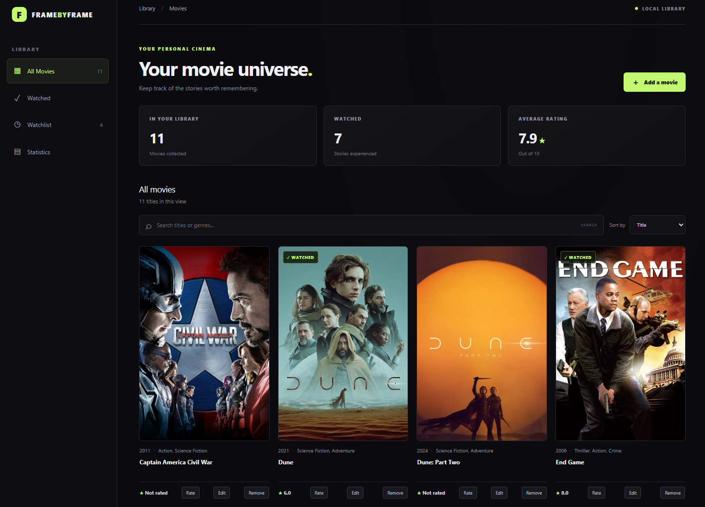
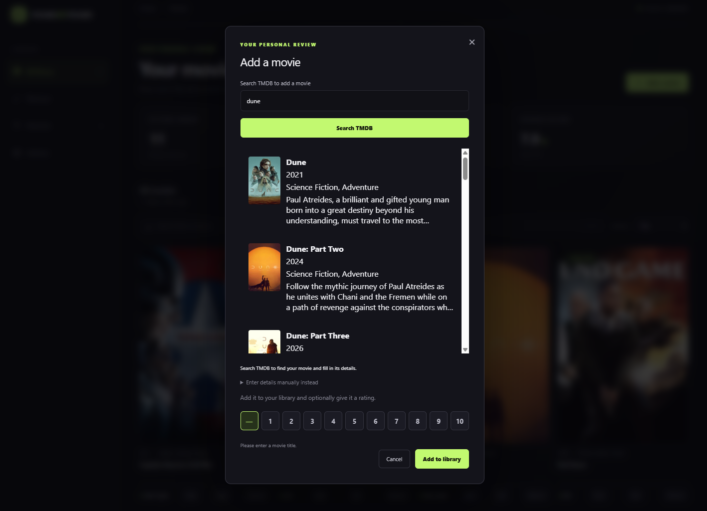
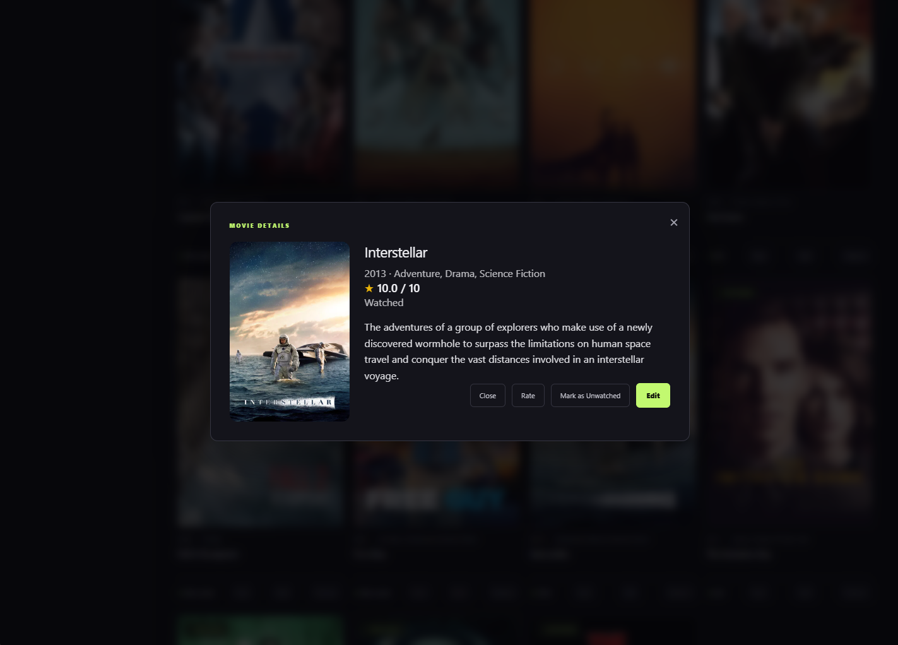
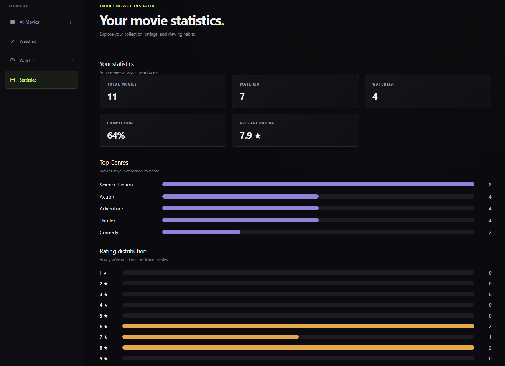

# FrameByFrame

A Windows desktop application for discovering, organizing, and rating movies. Built with Electron, React, TypeScript, and SQLite, FrameByFrame combines movie metadata from TMDB with a locally stored personal movie library.

## Features

- **Movie Discovery:** Search The Movie Database (TMDB) for movies, posters, descriptions, and genre information.
- **Personal Library:** Add and remove movies from your collection.
- **Ratings:** Rate movies on a 0–10 scale.
- **Watch Tracking:** Mark movies as watched or unwatched.
- **Movie Details:** View and edit saved movie information.
- **Library Organization:** Search, filter, and sort your collection.
- **Statistics Dashboard:** View summaries and statistics about your movie library.
- **Local Storage:** Persist movie information using SQLite without requiring a hosted database or account.

## Tech Stack

| Category | Technologies |
|---|---|
| Desktop | Electron, electron-vite |
| Frontend | React, TypeScript, Tailwind CSS |
| State Management | Zustand |
| Database | SQLite, better-sqlite3, Drizzle ORM |
| External API | TMDB API |
| Packaging | electron-builder, NSIS |

## Screenshots

### Movie Library



### Movie Discovery



### Movie Details



### Statistics Dashboard



## Installation

### Windows Installer

1. Visit the [GitHub Releases page](https://github.com/Pbrown34/FrameByFrame/releases).
2. Download the latest `FrameByFrame Setup` installer.
3. Run the installer and follow the installation instructions.
4. Configure your TMDB Read Access Token as described below.
5. Launch FrameByFrame.

**Note:** Windows may display a security warning because the installer is not code-signed.

### TMDB Configuration

FrameByFrame uses TMDB to retrieve movie information.

1. Create an account at [The Movie Database](https://www.themoviedb.org/).
2. Obtain an API Read Access Token through your TMDB account settings.
3. Create a `.env` file in `%APPDATA%\movie_rating_app`.
4. Add the following line:

```dotenv
TMDB_READ_ACCESS_TOKEN=your_token_here
```

5. Restart FrameByFrame.

Your token remains in your local configuration file. Do not commit it to GitHub.

## Development

### Prerequisites

- Node.js and npm
- Git
- TMDB API Read Access Token

### Local Setup

```bash
git clone https://github.com/Pbrown34/FrameByFrame.git
cd FrameByFrame
npm install
```

Create the TMDB `.env` file in the Electron user-data directory as described above.

Start the development application:

```bash
npm run dev
```

### Available Commands

| Command | Description |
|---|---|
| `npm run dev` | Start the Electron development application |
| `npm run build` | Build the application |
| `npm run typecheck` | Run TypeScript checks |
| `npm run dist:win` | Generate a Windows installer |

## Architecture

FrameByFrame separates its application into Electron's main and preload processes and a React renderer.

- **Electron Main Process:** Handles SQLite database operations, TMDB API requests, and application lifecycle management.
- **Preload Script:** Exposes a controlled interface for renderer-to-main communication using Electron IPC.
- **React Renderer:** Provides the application interface and handles user interactions.
- **SQLite Database:** Stores movie metadata, ratings, watched status, and notes locally.

The application uses Electron context isolation and disables Node.js integration in the renderer.

## Data Storage

Movie information is stored locally in the application's user-data directory using SQLite.

On Windows, the database is located at:

```text
%APPDATA%\movie_rating_app\framebyframe.sqlite
```

The library persists across application restarts and normal application updates.

## Acknowledgments

This product uses the TMDB API but is not endorsed or certified by TMDB.

Movie metadata and artwork are provided by [The Movie Database](https://www.themoviedb.org/).

## License

## License

This project is licensed under the MIT License. See the [LICENSE](LICENSE) file for details.